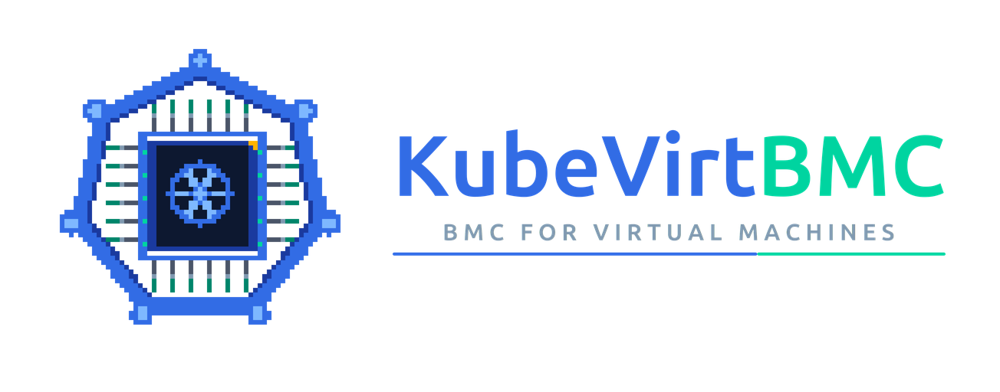

  

[Documentation](https://docs.kubevirtbmc.io) ·
[Quick Start](https://docs.kubevirtbmc.io/getting-started/) ·
[Helm Chart](https://charts.kubevirtbmc.io/) ·
[Releases](https://github.com/kubevirtbmc/kubevirtbmc/releases) ·
[Discussions](https://github.com/kubevirtbmc/kubevirtbmc/discussions)

---

## Overview

**KubeVirtBMC** provides out-of-band management for [KubeVirt](https://kubevirt.io) virtual machines. For each VM, it runs a virtual
Baseboard Management Controller (BMC) that speaks [IPMI](https://www.intel.com/content/www/us/en/products/docs/servers/ipmi/ipmi-second-gen-interface-spec-v2-rev1-1.html)
and [DMTF Redfish](https://www.dmtf.org/standards/redfish), the same protocols used to manage physical servers.

This lets bare-metal provisioning tools, such as [Metal3](https://metal3.io)/[Ironic](https://ironicbaremetal.org), [Tinkerbell](https://tinkerbell.org),
and [Seeder](https://github.com/harvester/seeder), manage KubeVirt VMs without changes. Teams can use VMs in place of physical hosts for CI pipelines,
development environments, and demos, which saves hardware and shortens bring-up time.

## Features

- **Declarative API**: create a `VirtualMachineBMC` custom resource and the controller manages the BMC lifecycle.
- **IPMI**: power on, off, soft, cycle, and reset, plus boot device selection (PXE, disk, CD-ROM) through `ipmitool` and other IPMI clients.
- **Redfish**: service root, `ComputerSystem` power actions, boot source override (`Once`/`Continuous`, `Legacy`/`UEFI`), and session or Basic authentication.
- **Redfish virtual media**: insert and eject ISO images. They are imported through [CDI](https://github.com/kubevirt/containerized-data-importer) with a configurable StorageClass, volume mode, and TLS trust.
- **One-shot boot overrides**: the VM's original boot order is captured and restored after a one-time boot, matching real BMC behavior.
- **Kubernetes-native credentials and exposure**: credentials come from a Kubernetes `Secret`. The BMC endpoint is exposed as a `ClusterIP`, `NodePort`, or `LoadBalancer` Service.
- **Standards conformance**: every change is tested in CI against the DMTF [Redfish-Service-Validator](https://github.com/DMTF/Redfish-Service-Validator), Redfish interoperability profiles, and an end-to-end Metal3 suite.

## Architecture

  

1. You create a `VirtualMachineBMC` that references a `VirtualMachine` and a credentials `Secret`.
2. The **controller manager** reconciles it into a per-VM **virtbmc** Deployment, Service, and RBAC.
3. The **virtbmc** pod serves IPMI and Redfish. It translates each request into KubeVirt API calls on the target VM.

## Documentation

For installation, configuration, and usage guides, see the [KubeVirtBMC documentation](https://docs.kubevirtbmc.io).

## Roadmap

To see what's shipped, what's in progress, and what's planned next, read [ROADMAP.md](ROADMAP.md).

## Community

- [Discord](https://discord.gg/k5hT9GDQkY)
- [GitHub Discussions](https://github.com/kubevirtbmc/kubevirtbmc/discussions)
- [GitHub Issues](https://github.com/kubevirtbmc/kubevirtbmc/issues)
- [Publications and talks](https://docs.kubevirtbmc.io/publications/)

## Contributing

Contributions are welcome, including code, docs, bug reports, and feedback. Read the [Contributing Guide](CONTRIBUTING.md) for the development
setup, the workflow, the branching and release strategy, and how to run the unit and end-to-end tests.

## Adopters

KubeVirtBMC is used by organizations including **SUSE**, **CLASTIX**, and **CESTC**. See [ADOPTERS.md](ADOPTERS.md) for the full list.
If you use KubeVirtBMC, please [add your organization](ADOPTERS.md) with a pull request.

## Security

Please **do not** report security vulnerabilities in public GitHub issues. Report them privately through
[GitHub Security Advisories](https://github.com/kubevirtbmc/kubevirtbmc/security/advisories/new).

## Code of Conduct

This project follows the [Contributor Covenant Code of Conduct](CODE_OF_CONDUCT.md). To report unacceptable behavior, contact [conduct@kubevirtbmc.io](mailto:conduct@kubevirtbmc.io).

## License

KubeVirtBMC is licensed under the [Apache License, Version 2.0](LICENSE).
